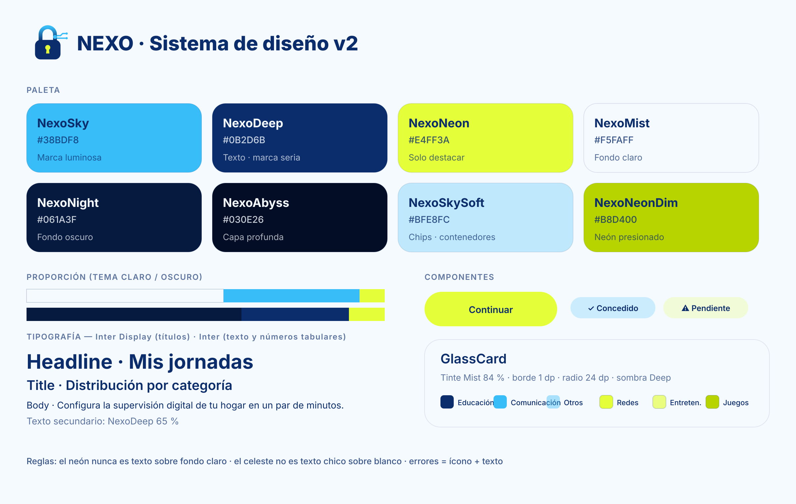

# NEXO — Sistema de diseño v2

Rediseño visual de la app (solo UI: colores, tipografía, logo, componentes y
animaciones). **No se tocó** ningún ViewModel, Room, WorkManager,
UsageStatsManager ni lógica de negocio.

Alcance: **versión acotada** decidida por el plazo (entrega 20/11/2026). Lo
que quedó fuera está listado al final como *trabajo futuro*.

---

## 1. Diagnóstico (antes del rediseño)

| # | Problema encontrado | Dónde | Estado |
|---|---|---|---|
| 1 | Colores sueltos y duplicados: 16 tokens (`NexoIce`, `NexoBorder`, `NexoDotOutline`, `NexoKeypadBorder`, `NexoChevron`…) sin roles claros | `Color.kt` y pantallas | ✅ Resuelto: 4 colores de marca + 4 derivados y roles semánticos (`NexoSemantica.kt`) |
| 2 | `NexoMute` (gris) fijo como texto secundario en ambos temas → contraste insuficiente en oscuro | Todas las pantallas | ✅ `NexoTextoSecundario` cambia con el tema (Deep 65 % / Mist 70 %) |
| 3 | `NexoIce` (claro) usado como fondo de pistas y de íconos también en tema oscuro | Estadísticas, Configuración, Permisos | ✅ `NexoContenedorSuave` según el tema |
| 4 | Tipografía mezclada: `FontFamily.Serif` en títulos + sans en el resto; tamaños sueltos (10.5, 12.5, 13.5 sp…) sin escala | Todas | ✅ Inter Display + Inter con escala M3 completa (`Type.kt`); `FontFamily.Serif` eliminado |
| 5 | Logo genérico: `Icons.Filled.Shield` de Material + texto Serif; ícono de app = escudo blanco sobre teal | Splash, ícono | ✅ Candado "NEXO" propio en VectorDrawable + ícono adaptativo y monocromático |
| 6 | `window.statusBarColor` deprecado y en conflicto con `enableEdgeToEdge` | `Theme.kt` | ✅ Eliminado; barras transparentes con íconos claros/oscuros según el fondo |
| 7 | Botones con radios distintos (10 y 12 dp) y CTA de colores distintos (Deep, Green) | Varias | ✅ `NexoBotonPrincipal` (cápsula neón, 52 dp) y `nexoBotonPrincipalColors()` |
| 8 | Componentes duplicados: `AvisoPermisoUso` (Home y Estadísticas), `MiniCard`/`ResumenCard` | Home, Estadísticas | ✅ Un solo `AvisoPermisoUso` en `ui/components` |
| 9 | Configuración sin scroll: las 9 filas se cortaban en teléfonos de 5" | `ConfiguracionScreen` | ✅ Scroll + filas agrupadas en GlassCard, 56 dp mín. |
| 10 | Etiqueta "Estadísticas" reducida a 10 sp para caber en la barra | `NexoBottomBar` | ✅ Barra nueva con etiquetas en `labelSmall` sin reducir |
| 11 | Emojis como íconos de estado (🟢 ⚪ 🏫 👋): se ven distintos en cada fabricante | Home | ✅ `ChipEstado` con ícono Material + texto |
| 12 | Errores indicados solo con color (coral) | PIN, formularios | ✅ `MensajeError` = ícono + texto (PIN, Informes, Configuración). ⚠️ Horarios/Excepciones/Pausas/Correo/Vincular siguen con texto sin ícono |
| 13 | Saludo "Buenos días" fijo a cualquier hora | Home | ✅ Según la hora |
| 14 | Espaciados que no son múltiplos de 4 (13, 18, 22, 26 dp) | Varias | ✅ En las pantallas rediseñadas. ⚠️ Pendiente en Horarios, Excepciones, Pausas, Apps supervisadas, Correo y Vincular cuenta (solo recibieron paleta y tipografía) |
| 15 | Barra de distribución "Utilidad vs. entretenimiento" con anchos mal calculados (cada segmento usaba el ancho *restante*) | Estadísticas | ✅ Segmentos con `weight` |
| 16 | Chips de días en Horarios de 32 dp (menos de 48 dp de toque) | Horarios | ⚠️ Pendiente (se dejó el tamaño para no romper el diálogo) |

---

## 2. Paleta (`ui/theme/Color.kt`)

| Token | Hex | Rol |
|---|---|---|
| `NexoSky` | `#38BDF8` | Marca luminosa: gradientes, gráficos, íconos, estados activos. Nunca texto chico sobre blanco |
| `NexoDeep` | `#0B2D6B` | Marca seria: texto, encabezados, barras, cuerpo del candado |
| `NexoNeon` | `#E4FF3A` | **Solo destacar**: CTA, tab activo, toggle, badges, dato clave, pulsos |
| `NexoMist` | `#F5FAFF` | Fondos y superficies del tema claro; texto del tema oscuro |
| `NexoNight` | `#061A3F` | Fondo del tema oscuro, Splash y PIN |
| `NexoAbyss` | `#030E26` | Capa más profunda |
| `NexoSkySoft` | `#BFE8FC` | Contenedores suaves y chips |
| `NexoNeonDim` | `#B8D400` | Neón presionado / categoría Juegos |

Valores finales = los del enunciado (no fue necesario ajustarlos). Cualquier
otro tono es uno de estos con `.copy(alpha = …)`. Ningún archivo fuera de
`Color.kt` declara `Color(0x…)`.

**Proporción**: claro Mist ~55 % · azules ~38 % · neón ~7 %; oscuro Night/Abyss ~60 % · azules ~30 % · neón ~10 %.

### Roles semánticos (`ui/theme/NexoSemantica.kt`)

Las pantallas usan estos nombres, nunca un color crudo:

| Rol | Claro | Oscuro |
|---|---|---|
| `NexoTextoSecundario` | Deep 65 % | Mist 70 % |
| `NexoAcento` (íconos, links) | Deep | Sky |
| `NexoContenedorSuave` | SkySoft 55 % | Deep 55 % |
| `NexoBorde` | Deep 12 % | Sky 15 % |
| `NexoTextoError` | Deep (+ ícono) | Neon (+ ícono) |
| `NexoAlertaFondo` / `NexoTextoAlerta` ("Pendiente") | Neon 20 % / Deep | Neon 15 % / Neon |
| `NexoExitoFondo` / `NexoTextoExito` | Sky 22 % / Deep | Sky 18 % / Sky |
| `nexoBotonPrincipalColors()` | Neon + texto Deep | igual |
| `nexoSwitchColors()` | pista Neon, perilla Deep | igual |

### Reglas de contraste

- El neón **nunca** es texto sobre fondo claro: en claro se usa como relleno con texto Deep encima (`DatoClave`, botón, chips).
- El celeste no es texto chico sobre blanco: rellenos, gráficos, íconos grandes y bordes.
- Texto en claro: Deep (nunca negro). Texto en oscuro: Mist.
- Errores y estados: siempre ícono + texto.
- Material You (color dinámico) desactivado: la marca se ve igual en todos los teléfonos.

### Color por categoría (`ui/theme/CategoriaColores.kt`, fuente única de verdad)

| Categoría | Color |
|---|---|
| Educación | Deep 100 % |
| Comunicación | Sky 100 % |
| Otros | Sky 40 % |
| Redes Sociales | Neon 100 % |
| Entretenimiento | Neon 65 % |
| Juegos | NeonDim 100 % |

En claro, los segmentos amarillos de gráficos llevan borde 1 dp Deep 20 %
(`esCategoriaNeon()`). El PDF (`InformePdfGenerator`) usa el mismo mapa vía
`colorDeCategoria()`; se quitó el respaldo a `NexoCoral`.

---

## 3. Tipografía (`ui/theme/Type.kt`, `res/font`)

- **Inter Display** (SemiBold/Bold/ExtraBold) para títulos y el logo; **Inter** (Regular/Medium/SemiBold/Bold) para texto y números. Licencia SIL Open Font License 1.1.
- Se eligió Inter Display en vez de Sora/Space Grotesk porque estaba disponible sin descargas en el entorno de trabajo y mantiene el aire tecnológico.
- Escala Material 3 completa (display → label). Display y contadores usan **números tabulares** (`fontFeatureSettings = "tnum"`).
- `NexoFuenteTitulos` mapea el peso "Normal" al archivo SemiBold, así cualquier título viejo con `fontFamily = NexoFuenteTitulos` ya se ve como título.

---

## 4. Logotipo — candado "NEXO"

- **Cuerpo**: rectángulo redondeado (radio 22 % del ancho) en Deep.
- **Arco**: grueso, degradado Sky → Deep. Se anima aparte (abre/cierra).
- **Nodo de circuito** en la pata derecha del arco, del que salen 2 pistas con vías → de ahí nace la red de `CircuitField`.
- **Ojo de cerradura** clásico en Neon: el único acento del logo.
- **Palabra**: Inter Display ExtraBold, tracking +6 %, Deep en claro / Mist en oscuro. En los SVG/VectorDrawable va convertida a paths.
- En oscuro el cuerpo lleva un borde Sky 60 % para separarse del fondo Night.

Variantes (en `res/drawable/` y fuentes SVG en `design/logo/`):

| Archivo | Uso |
|---|---|
| `logo_mark` / `logo_mark_oscuro` | Solo candado (claro / oscuro) |
| `logo_full_vertical(_oscuro)` | Candado + NEXO abajo |
| `logo_full_horizontal(_oscuro)` | Candado + NEXO a la derecha |
| `logo_mono` | Un color (ojo recortado) para notificaciones |
| `ic_launcher_foreground` / `_background` / `_monochrome` | Ícono adaptativo (zona segura 66 dp) + monocromático Android 13 |
| `splash_icon` | Splash del sistema Android 12+ (candado abierto) |

El logo animado (`NexoLogo`) dibuja **exactamente la misma geometría**
(`GeometriaCandado`, lienzo de 100 u) con Canvas, para que el estático y el
animado calcen al píxel. Se lee bien a 24 dp, 48 dp y grande.

Para regenerar todo: `python3 design/scripts/gen_logo.py Nexo_App` (requiere
`fontTools` y la fuente Inter Display ExtraBold; editar la ruta de la fuente
en el script) y `python3 design/scripts/gen_mockups.py Nexo_App` (requiere
`rsvg-convert`).

> **Claude Design**: no estaba disponible en el entorno donde se hizo el
> rediseño (tampoco había red para descargar dependencias). Siguiendo el plan
> B del enunciado, las propuestas se generaron como SVG con un script y se
> eligió la que mejor funciona a 24/48 dp (cuerpo macizo + ojo neón; las
> pistas del circuito se mantienen cortas para no ensuciar el ícono chico).

---

## 5. Componentes (`ui/components/`)

| Componente | Qué hace |
|---|---|
| `NexoGradientBackground(intensidad)` | Malla de gradiente animada estilo *shadergradient* hecha con Canvas: 3–4 manchas radiales que se desplazan lento + veta neón fina. `ALTA` (Splash/PIN), `MEDIA` (onboarding), `BAJA` (dashboards: solo arriba, se desvanece al fondo). |
| `CircuitField(modo)` | Red PCB procedural con semilla fija (pistas ortogonales con quiebres a 45°, ramas y vías). `INTRO` (se traza en cascada), `LOOP` (pulsos tipo cometa Sky/Neon, las vías destellan al llegar), `TENUE` (fondo del PIN). Paths cacheados en `drawWithCache`; tiempo leído solo en la fase de dibujo. |
| `NexoLogo(variante)` | `MARK`/`VERTICAL`/`HORIZONTAL`. Respiración 1.00↔1.035 en 3.2 s (seno), glow del ojo, reflejo diagonal cada 4 s, apertura/cierre del arco, temblor de "no abre". |
| `PalabraNexo` | La palabra NEXO letra por letra (para la animación del Splash). |
| `GlassCard` | Tinte Mist 84 % / Night 72 %, borde 1 dp, radio 24 dp, sombra suave Deep, reflejo superior. |
| `NexoBotonPrincipal` | Cápsula neón 52 dp, texto Deep, escala 0.96 con spring al presionar, glow neón en oscuro. |
| `ChipEstado` | Badge ícono + texto: `EXITO`, `ALERTA`, `ERROR`, `NEUTRO`. |
| `MensajeError` | Ícono + texto de error. |
| `DatoClave` | El dato más importante: píldora neón (claro) / texto neón (oscuro). |
| `ContadorAnimado` | Count-up de 600 ms con números tabulares. |
| `DonaCategorias`, `BarraAnimada` | Dona y barras que se dibujan/crecen al aparecer, con borde fino en segmentos neón. |
| `IndicadorPasos` | Pasos del onboarding; el actual en neón. |
| `NexoCargando` | Logo respirando + 6 pistas con pulsos (indicador de carga / estado vacío). |
| `AvisoPermisoUso` | Aviso de permiso pendiente (antes duplicado). |
| `rememberAnimacionesActivas()`, `rememberRelojAnimacion()`, `Modifier.entradaEnCascada(i)` | Utilidades de movimiento: respetan "Quitar animaciones" y pausan los bucles fuera de RESUMED. |

Cada componente base tiene `@Preview` en claro y oscuro.

`NexoBottomBar` es ahora una cápsula flotante con píldora neón que se desliza
con spring entre pestañas (ícono/texto del tab activo en Deep).

---

## 6. Pantalla de carga (Splash)

| Tiempo | Qué pasa |
|---|---|
| 0 ms | Splash del sistema (Android 12+): `splash_icon` (candado abierto) sobre Night. El Compose dibuja el mismo candado a 128 dp centrado → empalma sin salto. En API < 31 la ventana ya arranca en Night (sin destello blanco). |
| 0–300 ms | Fade del gradiente ALTO; candado en su sitio con el arco abierto. |
| 200–900 ms | `CircuitField` INTRO: las pistas se trazan desde el logo hacia los bordes en cascada; las vías se encienden al llegar. |
| 600–950 ms | "NEXO" aparece letra por letra (fade + 6 dp, 50 ms entre letras). |
| 900 ms → fin | LOOP: el logo respira, pulsos por los circuitos, reflejo en el candado. |
| fin de carga (≥ 1.3 s) | Los pulsos convergen (350 ms) → el candado se cierra (spring, destello neón, vibración `Confirm`) → onda de luz Sky → siguiente pantalla. |

Duración total ≈ 2.1 s (antes: 2 s fijos). Si la consulta a Room tarda más,
se queda en el LOOP. Con "Quitar animaciones": fotograma estático (candado
cerrado, circuitos encendidos) y fade de navegación.

---

## 7. Dónde se aplicó

| Pantalla | Tratamiento |
|---|---|
| Splash | Coreografía completa (sección 6) |
| Verificar / Crear / Cambiar PIN y diálogo de PIN | Gradiente ALTO + circuitos TENUES + logo respirando con arco abierto; teclado de vidrio; puntos neón con "pop"; **PIN incorrecto**: puntos tiemblan + arco "no abre" + vibración `Reject`; **PIN correcto**: el candado se cierra (520 ms) antes de navegar |
| Config inicial, Permisos | Gradiente MEDIO, indicador de pasos, GlassCard, botón neón, chips de estado |
| Home | Gradiente BAJO, saludo por hora, estado de jornada en GlassCard grande, resumen con contadores, dato clave de distracción, CTA "Crear jornada" |
| Estadísticas | Dona por categoría, barras que crecen, dato clave de distracción, línea de tiempo con degradado, entrada en cascada |
| Configuración | Filas agrupadas en GlassCard con scroll, switch neón |
| Acerca de | Logo grande con reflejo + circuitos en LOOP lento |
| Informes | Tarjetas nuevas, punto de color por categoría en el detalle, error con ícono |
| Horarios, Excepciones, Pausas, Apps supervisadas, Correo, Vincular cuenta | Paleta, tipografía de títulos, botón neón y switches neón (estructura sin cambios) |
| Navegación | Fade + escala suave entre pantallas |

---

## 8. Compatibilidad y rendimiento

- **Todo funciona igual en API 26–36**: no se usan shaders AGSL ni `RenderEffect`, solo Canvas. Por eso no hay tres niveles distintos.
- Animaciones infinitas pausadas fuera de `RESUMED` (`repeatOnLifecycle`).
- Tiempo leído en la fase de dibujo (`drawBehind`/`drawWithCache`/`graphicsLayer`): las animaciones en bucle no recomponen.
- Paths de los circuitos cacheados (se recalculan solo si cambia el tamaño).
- Sin motores 3D.
- Si el Splash no llega a 60 fps en un gama media: bajar `densidad` del `CircuitField` (14 → 10) antes que quitar efectos.

---

## 9. Trabajo futuro (fuera del MVP por plazo)

- Vidrio líquido real con `io.github.kyant0:backdrop` (blur del fondo, lens, vibrancy) y los controles `LiquidButton/Toggle/Slider/BottomTabs`.
- Shaders AGSL (API 33+): malla *shadergradient* con grano y reflejo metálico *liquid-logo* dentro del candado.
- `LiquidBlob` (liquid morph), inclinación con giroscopio, parallax por capas y flip 3D de los informes.
- Glow con `RenderEffect` (API 31+).
- Llevar las 6 pantallas de formularios (Horarios, Excepciones, Pausas, Apps, Correo, Vincular) al mismo nivel de las rediseñadas: GlassCard, espaciados de 4 dp, errores con ícono y chips de días de 48 dp.
- Mockups hechos en Claude Design cuando esté disponible.

---

## 10. Qué probar en el teléfono

1. Abrir la app en frío: el candado del splash del sistema no debe "saltar" al aparecer el Splash animado.
2. Splash completo: pistas → letras → pulsos → cierre con vibración → PIN.
3. PIN incorrecto (vibración + temblor) y correcto (clic del candado).
4. Ajustes → Tema oscuro: revisar Home, Estadísticas, Configuración en ambos temas.
5. Opciones de desarrollador → Escala de animación del animador = desactivada: todo estático y sin esperas largas.
6. Ícono de la app en el launcher (y el monocromático en Android 13+ con íconos temáticos).
7. Descargar un informe PDF y revisar los colores nuevos.
